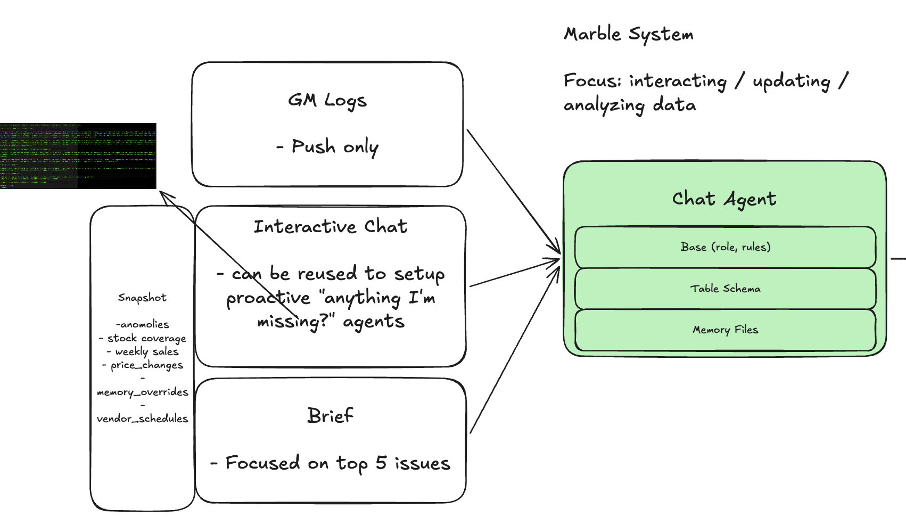
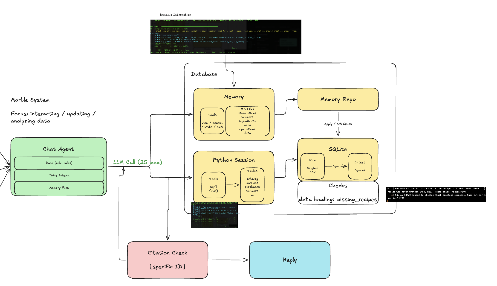

# Architecture

## Overview

1. Built a harness that updates memory in a file (memory.md).
2. Used python sessions as a tool for maximum flexibility and features.
3. Added table schemas / memory file as references that agent can search.
4. Added pre/post processing steps: citation regex id checks / missing_recpies (just one example), and snapshots context in system prompt (Adding to user message instead of system prompt could potentially cache tokens if snapshots change frequently).

## Entry points and chat agent



Used one agent with different context loaded depending on specific role.

GM Logs: focuses on updating memory
Interactive chat: Dynamic chat + subagent pattern for analysis.
Briefs: focuses on top 5 issues and looks at memory + database.

Agent gets exploratory behavior (backend/prompts.py), table query tools (@backend/workspace.py:34), memory tools (@backend/memory.py:39 ).
Cleanup was not implemented to focus on recall, but system is designed so cleanup can be implemented in a separate agent or sequential pipeline.

## Internals: agent, Python session, memory, and database



Used Python session to leverage "claude code/codex"-like capabilities for querying / aggregating / analyzing. Additional work around sandbox as tool_call guardrails was skipped.

Added some hooks (descriptive function_call error messages, citation regex checks) were added, allowing agents to make more llm_calls for greater alignment.

Memory / database is updated through tool_call. "markdown set/map --> parse --> sync".

Sturctured operations (like callback or tool_call) is more ideal, but aimed to get it working within the time window.

Example 'sync' command that is saved in memory.md:

```
### Mappings
Format: - map <SKU> -> <kitchen ingredient name> [sources]
- map AW-CHK20 -> Chicken thigh boneless skinless [N03, N11, CAT-CHICKEN20]

### Overrides
Format: - set vendor <vendor_id> delivery_days|order_cutoff = <value> (optional: from YYYY-MM-DD) [sources]
Format: - set invoice <invoice_id> entered_status = <value> [sources]
```

## Production Failures

1. I added specific columns like order_cutoff, previous_delivery_days, etc.. and added checks of missing_recepie mappings that fit to the issues in this dataset.
2. If some issues are not resolved by users, or there are contradictions in data, snapshots / briefs can provide 'lack of context' outputs.
3. Currently, there is no deletion of memories. Some irrelevant notes are added by the agents.
4. Snapshot calculations need to be reviewed / evaluated in depth to not miss any critical issues.
5. LLM / tool_call optimization: potentially with subagents / removing traces for multi-turn api call.

Will need some iterations / domain knowledge to restructure the schemas.
